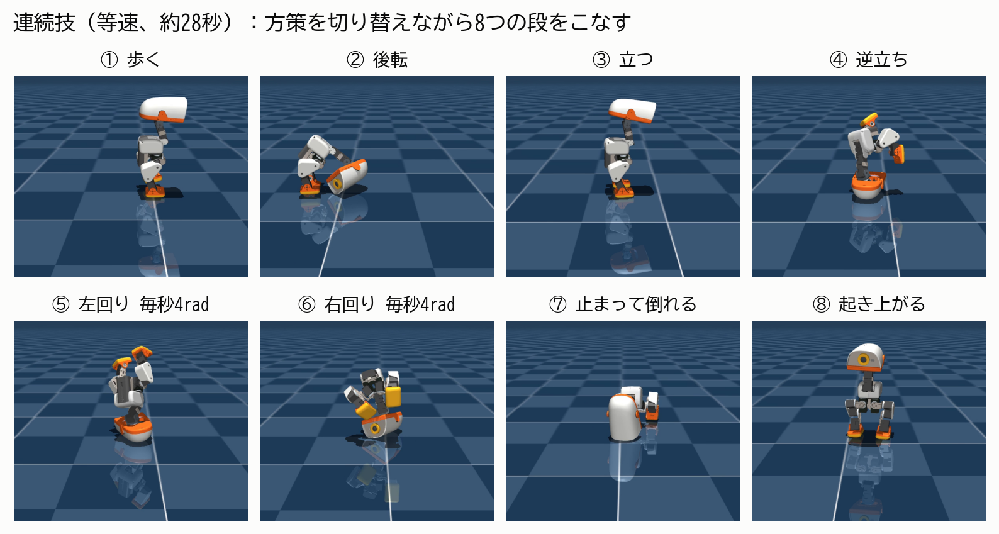
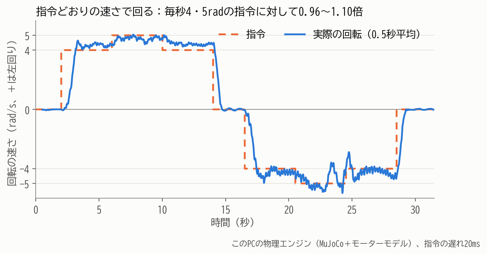

# microduck-acrobatics

小型の二足ロボット Microduck（Pollen Robotics）に、強化学習で**ヘッドスピン**と**後転**を教え、方策（技ごとに学習したニューラルネットワーク）を切り替えて**連続技**にしたコードです。松尾研 Physical AI 応用講座の最終課題として作りました。実機は使わず、すべてシミュレーションです。

- 動画：（YouTube の URL を記載）
- 説明資料：説明資料_PAI最終課題_＜アカウント名＞.pdf



## 結果

学習とは別の物理エンジン（CPU の MuJoCo と、サーボのモデル BAM）で、条件をばらつかせて測りました。

| 項目 | 結果 |
| --- | --- |
| 連続技（歩く→後転→立つ→逆立ち→左回り→右回り→止まる→倒れる→起き上がる） | 50回中50回成功（モーター指令の遅れ15〜30ms） |
| ヘッドスピンの速さ（指令 毎秒4・5rad） | 指令の0.96〜1.10倍。止まれで止まる |
| 後転（指令の遅れなしで、きれいに転がれた回数） | 改善前 17/50 → 改善後 50/50 |
| 弱点 | 指令の遅れが5ms以下だと、ヘッドスピンが回りきれない |



## フォルダ

| フォルダ | 中身 |
| --- | --- |
| `tasks/` | 学習の設定（逆立ち、後転、ヘッドスピン、遅れに強い版、速い版）とテスト |
| `installers/` | `tasks/` を microduck_rl に入れるインストーラーと、その作り方 |
| `training/` | 学習を順番に回す仕組みと、実際に回した学習の一覧（`jobs.txt`） |
| `bench/` | 評価ツール（技単体、方策の比較、連続技、図、動画）とテスト |
| `mjlab_tools/` | 学習時の物理エンジン（MuJoCo Warp）での確認と動画 |
| `policies/` | 書き出した方策（ONNX） |
| `results/` | 評価の結果（表と図）と、学習の推移 |

## 方策（`policies/`）

| ファイル | 技 | 学習（`training/jobs.txt`） |
| --- | --- | --- |
| `headspin_robust.onnx` | ヘッドスピン（連続技で使用） | 2) 遅れに強い版、`headspin.onnx` の続きから2,000反復 |
| `headspin.onnx` | ヘッドスピン（改善前） | 1) 前作の逆立ちの続きから3,000反復 |
| `backroll_robust.onnx` | 後転（連続技で使用） | 3) 遅れに強い版、前作の後転の続きから3,000反復 |
| `backroll.onnx` | 後転（前作） | この課題の前に学習 |
| `headstand.onnx` | 逆立ち（前作） | この課題の前に学習 |
| `headspin_fast5.onnx`, `headspin_fast6.onnx` | 速さの限界を探った版 | 4) 指令の上限を毎秒5・6rad にして各2,500反復 |
| `checkpoints/headspin_it1000.onnx`, `it2000` | ヘッドスピンの学習途中 | 1) の1,000・2,000反復目 |

歩く・立つ・起き上がる・前転は、Microduck の公開の方策（`alpha_walking.onnx`、`alpha_stand.onnx`、`roulade.onnx`）を使っています。このリポジトリには含めていません。

`results/` の表の方策名は、学習の記録の名前のままです（`job2_HeadSpin_12998` = `headspin.onnx`、`job3_HeadSpinRobust_14997` = `headspin_robust.onnx`、`job2_BackRollRobust_12998` = `backroll_robust.onnx`）。

## 使い方

### 1. 学習

```bash
git clone https://github.com/pollen-robotics/microduck_rl && cd microduck_rl
git checkout 53b8971b61baf5b7f3c16d135dd7cac37623de4b
python3 ../microduck-acrobatics/installers/setup_acrobatics.py
uv run --with pytest pytest tests/test_headspin_cfg.py tests/test_robust_cfg.py -q
uv run train Mjlab-HeadSpinRobust-Flat-MicroDuck --env.scene.num-envs 2048 --agent.logger tensorboard
```

実際に回した学習（続きから学習する設定も含む）は `training/jobs.txt` にあります。`bash training/night_queue.sh training/jobs.txt` で上から順に回せます。方策の書き出しには microduck_rl の `scripts/export.py` を使います。

### 2. 評価（CPU の MuJoCo）

microduck_rl の `scripts/infer_policy.py` が動く Python 環境（mujoco、onnxruntime、numpy、BAM）に、imageio と pillow を足して使います。

```bash
export MICRODUCK_RL=/path/to/microduck_rl                 # BAM のモデルとロボットのモデルを読む
export MICRODUCK_POLICIES=/path/to/published/policies     # alpha_stand.onnx など公開の方策
python bench/tests/test_sim.py
python bench/battery.py backroll -n 50 --delay none --policy backroll=policies/backroll_robust.onnx
python bench/compare.py --role headstand --onnx policies/headspin.onnx policies/headspin_robust.onnx \
    --scenarios headspin headspin_slow headspin_fast -n 10 --delay train
python bench/routine.py -n 50 --delay train --policy backroll=policies/backroll_robust.onnx \
    --policy headstand=policies/headspin_robust.onnx --spin "4:4,-4:4" --headstand-s 3
```

`--delay train` は学習と同じく、モーター指令を試行ごとに15〜30ms遅らせます。`--delay none` は遅れなし、`--delay N` は 5ms × N です。

### 3. 図と動画

```bash
python bench/figures.py                         # results/figures/ を作り直す（matplotlib）
python bench/render_spin_tracking.py policies/headspin_robust.onnx results/headspin/spin_tracking_14997_w45.mp4 \
    --script "0:2,4:4,5:4,4:4,0:2.5,-4:4,-5:4,-4:4,0:3"
python bench/render_clip.py backroll_compare results/clips/backroll_compare.mp4
python bench/make_video.py results/final/final_video.mp4
```

`make_video.py` は、`bench/make_video.py` の `SCENES` にある動画（`render_clip.py` の4つ、`render_spin_tracking.py`、`routine.py --videos 1 --video-size 1280x720` の連続技）を先に作ってから実行します。文字は Windows 標準の BIZ UDゴシック（SIL Open Font License）を `/mnt/c/Windows/Fonts` から読みます。

### 4. 学習時の物理エンジンでの確認

```bash
cd microduck_rl   # setup_acrobatics.py を入れたもの
PYTHONPATH=$PWD/src python ../microduck-acrobatics/mjlab_tools/headspin_check.py ../microduck-acrobatics/policies/headspin_robust.onnx
```

## 補足

- 回転の向き：指令 +wz は上から見て反時計回り（左回り）です。評価ツールのラベル `right2` などは +wz を指します（結果の記録に合わせて名前を残しています）。
- 前作の逆立ち・後転は、この課題の前に学習したものです。逆立ちの公開版の設定は、ヘッドスピンの土台として整理したもので、前作の学習時の設定とは一部異なります。ヘッドスピン以降の学習環境が、実際に学習に使ったものと同じであることは、設定の全項目の照合と、同じ方策で700ステップ動かしたときの観測値・報酬の一致（差0）で確かめています。
- 後転のため、インストーラーは microduck_rl の `tasks/mdp.py` に9か所の小さな書き換えを入れます（転がる向きと、頭が床に着く判定の範囲を技ごとに設定できるようにするもの。既定値では前転はそのまま）。

## ライセンスと元にしたもの

このリポジトリは Apache License 2.0 です（`LICENSE`）。次のものを元にしています。各ライセンスは配布元を参照してください。

- [microduck_rl](https://github.com/pollen-robotics/microduck_rl)（Pollen Robotics、Apache-2.0）：ロボットのモデル、学習環境、公開の方策
- [mjlab](https://github.com/mujocolab/mjlab)、[MuJoCo](https://github.com/google-deepmind/mujoco)、[MuJoCo Warp](https://github.com/google-deepmind/mujoco_warp)：物理エンジンと学習の枠組み
- [rsl_rl](https://github.com/leggedrobotics/rsl_rl)：強化学習（PPO）
- [BAM](https://github.com/Rhoban/bam)：サーボモーターのモデル
